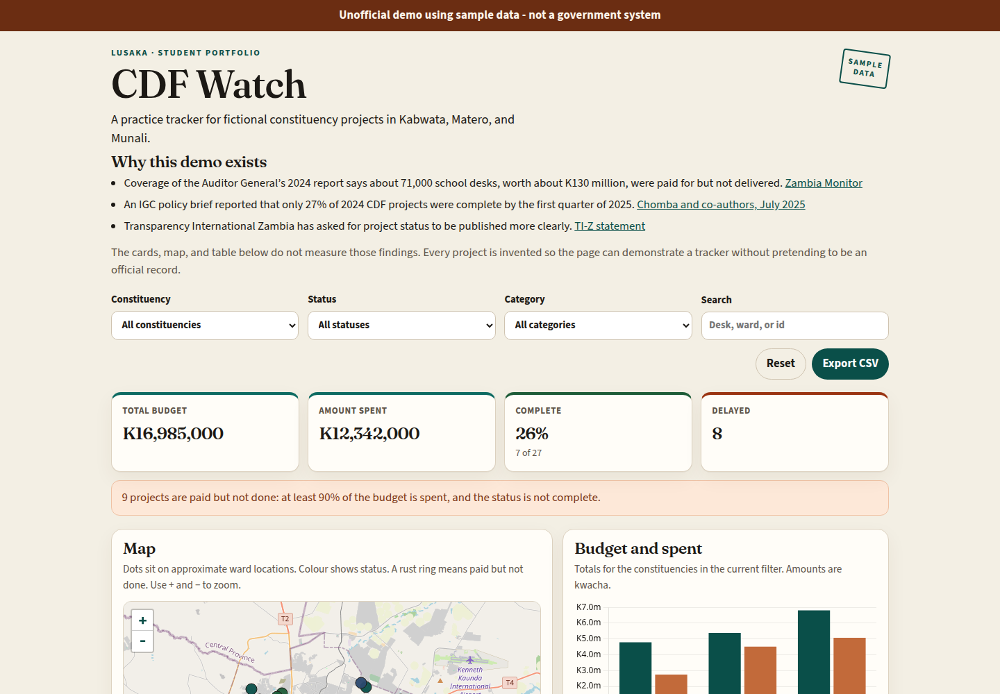
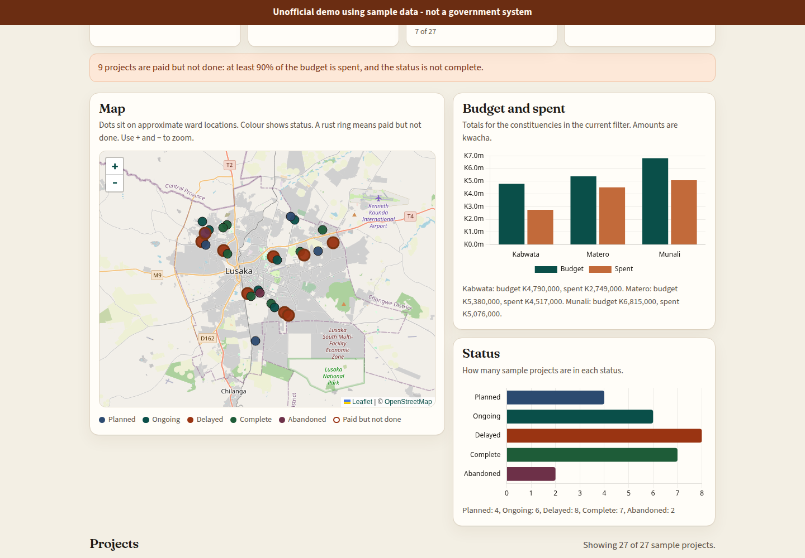
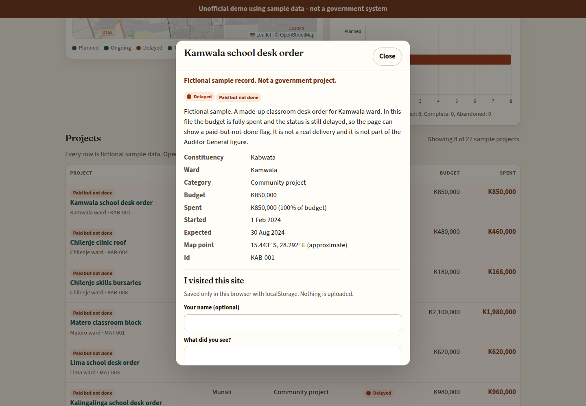
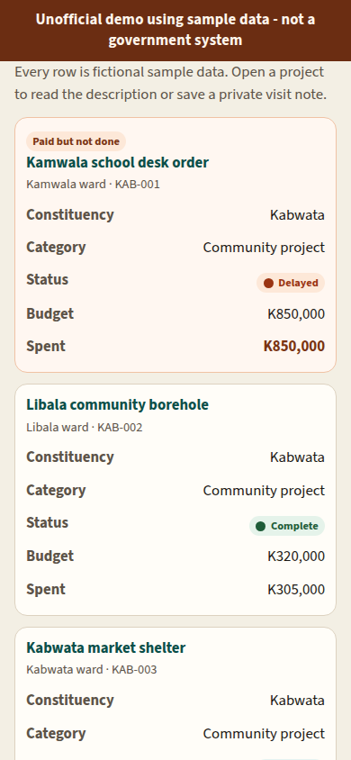

# CDF Watch

Unofficial demo using sample data - not a government system.

CDF Watch is a small website that lists **fictional** Constituency Development Fund projects for three Lusaka constituencies: Kabwata, Matero, and Munali. It is a portfolio project by Wankumbu Musunga ([GitHub @MKBright](https://github.com/MKBright)), built to practise HTML, CSS, and JavaScript.

It is not a government system. It does not use government logos. The projects, budgets, and coordinates in the data files are made up.

## The problem

Public reporting has raised two worries about CDF: projects get paid for before the work is finished, and it is hard for a resident to see the status of a project.

- Coverage of the Auditor General’s 2024 report says about 71,000 school desks, worth about K130 million, were paid for but not delivered. [Zambia Monitor](https://www.zambiamonitor.com/zambia-auditor-generals-2024-report-reveals-k130-million-cdf-funded-desks-undelivered-despite-full-payment/)
- An IGC policy brief by Chomba and co-authors (July 2025) reported that only 27% of 2024 CDF projects were complete by the first quarter of 2025. [PDF](https://www.theigc.org/sites/default/files/2025-08/Chomba-et-al-Policy-Brief-July-2025.pdf)
- Transparency International Zambia has asked for project status to be published more clearly. [TI-Z statement](https://tizambia.org.zm/2025/03/ti-z-reaffirms-its-call-for-accountability-in-the-utilization-of-the-constituency-development-fund-cdf/)

This page does not measure those findings. The 27% figure above is from the IGC brief. The percent on the dashboard is only the share of **these fictional rows** marked complete.

## Screenshots

The brown bar at the top of every view says: "Unofficial demo using sample data - not a government system".









## What you can do

- Filter by constituency, status, and category, and search by ward, title, or id.
- Read four summary cards: total budget, amount spent, percent complete, and how many projects are delayed.
- See a flag on projects that are **paid but not done**: spent is at least 90% of the budget, and the status is not complete.
- Look at a map. The dot colour is the status. A rust ring means the flag is on.
- Open a project. The same panel has an "I visited this site" form. The note stays in this browser only.
- Download the rows that match the current filter as a CSV file.

With the sample that ships in this repository, the cards show:

| Card | Value | How it is calculated |
| --- | --- | --- |
| Total budget | K16,985,000 | Sum of `budget_zmw` |
| Amount spent | K12,342,000 | Sum of `spent_zmw` |
| Complete | 26% | 7 complete projects out of 27, rounded |
| Delayed | 8 | Rows whose status is `delayed` |

Nine of the 27 rows are paid but not done.

## Run it on your computer

You need Python 3, which can serve the folder. You do not need to install libraries for the website itself.

```bash
python3 -m http.server 8080
```

Open [http://localhost:8080](http://localhost:8080). Do not open `index.html` by double-clicking it. Browsers block the page from reading `data/projects.json` when the address starts with `file://`.

The map tiles come from OpenStreetMap, so the dots still show if you are offline, but the streets behind them need a network connection.

## Put it on GitHub Pages

The links in this project are relative (`css/styles.css`, not `/css/styles.css`). That is what makes the site work in a subfolder.

1. Merge this project into the `main` branch when you are happy with it.
2. In the repository settings, open Pages.
3. Deploy from the `main` branch, folder `/` (root).
4. The site will be at `https://mkbright.github.io/zambia-cdf-watch/`.

There is a `.nojekyll` file so GitHub Pages serves every folder, including `data/` and `vendor/`.

## Update the sample data

Edit `data/projects.csv`. That file is the one you change. Then rebuild the JSON the website reads:

```bash
python3 scripts/csv_to_json.py
```

Refresh the browser.

Each row needs these columns:

`id`, `constituency`, `ward`, `category`, `title`, `description`, `budget_zmw`, `spent_zmw`, `status`, `start_date`, `expected_date`, `lat`, `lng`, `sample`

Rules the script checks:

- `sample` must be the word `fictional` on every row.
- `category` is `community`, `bursary`, or `empowerment`.
- `status` is `planned`, `ongoing`, `delayed`, `complete`, or `abandoned`.
- Money is a whole number of kwacha, with no commas.
- Dates look like `2024-03-01`, and the expected date is not before the start date.
- Ids are unique.

The script always writes `"fictional": true` into the JSON. A row cannot be marked as a real government record by accident.

Ward names are real Lusaka wards. The latitude and longitude are approximate public points so the dot sits in the right part of the city. They are not survey marks, and the projects attached to them are invented.

## How it works

This is the version to explain in an interview.

1. **The CSV is the source, the JSON is what the browser loads.** `scripts/csv_to_json.py` reads the spreadsheet and writes `data/projects.json`, with a disclaimer at the top. A test fails if the two files drift apart, so you cannot forget to regenerate the JSON.

2. **The page finds the data next to itself.** `js/app.js` loads `../data/projects.json` using the script’s own address. On your laptop that is `http://localhost:8080/data/projects.json`. On GitHub Pages it is `https://mkbright.github.io/zambia-cdf-watch/data/projects.json`. A leading slash would skip the `zambia-cdf-watch` folder and break the hosted site.

3. **One filtered list feeds every view.** Changing a dropdown calls `filterProjects()` in `js/logic.js`. The cards, both charts, the map, and the table are all drawn from that same list. They cannot show different totals.

4. **The maths lives in `js/logic.js`, away from the page.** That file does not touch HTML. `node --test` imports it directly. The page only displays what those functions return.

5. **The flag is one comparison.** `isPaidButNotDone()` is true when `spent_zmw / budget_zmw` is at least `0.9` and `status` is not `complete`. A budget of zero is not flagged, so the page does not divide by zero.

   Two rows in the sample make the rule easy to point at:

   - **KAB-001 Kamwala school desk order** — budget K850,000, spent K850,000, status `delayed`. The share is 100% and the work is not complete, so the flag is on. The description says it is not one of the real desks from the audit.
   - **KAB-002 Libala community borehole** — budget K320,000, spent K305,000, status `complete`. The share is about 95%, but the status is complete, so there is no flag.

6. **Percent complete is a count, not a money ratio.** It is `complete projects / all projects in the current filter`, then rounded to the nearest whole number for the card. Seven out of 27 is 25.9%, which rounds to 26%. An empty filter shows 0%, not `NaN`.

7. **Visit notes never leave the computer.** The form writes to `localStorage` under the key `cdf-watch-visit-notes`. Clearing the browser’s site data deletes them. There is no server and no account.

8. **Export uses the same filter.** "Export CSV" turns the visible rows into a file with `projectsToCsv()`. The file has a `paid_but_not_done` column (`yes` or `no`) and a `fictional` column. Text that contains a comma is quoted. A cell that starts with `=` gets a leading apostrophe so a spreadsheet does not treat it as a formula.

The map is [Leaflet](https://leafletjs.com/) with [OpenStreetMap](https://www.openstreetmap.org/copyright) tiles. The charts are [Chart.js](https://www.chartjs.org/). Both are stored in `vendor/` so the page does not depend on a third-party script host. Dot colours are the CSS variables `--status-planned`, `--status-ongoing`, `--status-delayed`, `--status-complete`, and `--status-abandoned`.

## Tests

No install step. From the project folder:

```bash
npm test
```

That runs:

```bash
node --test
python3 -m unittest tests/test_csv_to_json.py
```

`package.json` has `"type": "module"` so Node can import `js/logic.js`.

The JavaScript tests check the flag boundary (exactly 90% flags, 89.9% does not, a finished project does not), the summary totals, combined filters, the chart helpers, CSV quoting, the sample file, and that the HTML banner and asset paths stay relative.

The Python tests check that bad rows are rejected and that `data/projects.csv` and `data/projects.json` match.

GitHub Actions runs the same commands on every push and pull request (`.github/workflows/test.yml`).

## Files

```
index.html                 the only page, including the banner
css/styles.css             layout, including the phone layout
js/logic.js                filters, totals, flag, CSV
js/app.js                  connects the page to logic.js
data/projects.csv          sample projects (edit this)
data/projects.json         generated file the browser loads
scripts/csv_to_json.py     CSV to JSON
tests/                     automated checks
vendor/                    Leaflet 1.9.4 and Chart.js 4.4.6
.github/workflows/test.yml the test workflow
```

## What this demo is not

- It is not an official CDF record and it is not affiliated with any public office.
- The budgets are not the national K130 million desk figure. Three sample desk orders exist so the flag is visible. They are labelled fictional in the description.
- The 26% on the card is not the IGC finding that 27% of real 2024 projects were complete.
- A visit note is not sent anywhere. It is not evidence.

## Libraries

- Leaflet 1.9.4, BSD-2-Clause, in `vendor/leaflet/`
- Chart.js 4.4.6, MIT, in `vendor/chart.js/`
- Map tiles © OpenStreetMap contributors

## Disclaimer

Unofficial demo using sample data - not a government system. Do not use it for oversight, payment, or audit decisions.
